# Kuljeet's Portfolio

A responsive developer portfolio built with React and TypeScript. The experience combines an interactive 3D desk, a macOS-inspired desktop interface, project and skills showcases, a Linux dotfiles guide, and an email-backed contact form.

**Live site:** [kuljeet.online](https://kuljeet.online)

## Contents

- [Overview](#overview)
- [Screenshots](#screenshots)
- [Features](#features)
- [Technology](#technology)
- [Routes and architecture](#routes-and-architecture)
- [Getting started](#getting-started)
- [Contact configuration](#contact-configuration)
- [Deployment](#deployment)
- [Project structure](#project-structure)
- [Updating content](#updating-content)

## Overview

This repository contains the portfolio frontend and its Vercel contact function. The home page presents an introduction, interactive About section, skills, projects, and contact options. Separate routes provide a resume viewer and an interactive guide to a Linux desktop configuration.

The interface uses a dark visual theme, responsive layouts, and motion to make the sections feel connected. Desktop, watch, and tablet imagery below shows how the same portfolio content is presented across different device-inspired layouts.

## Screenshots

### Hero and 3D desk

The hero includes a draggable 3D desk rendered in the browser.

<p align="center">
  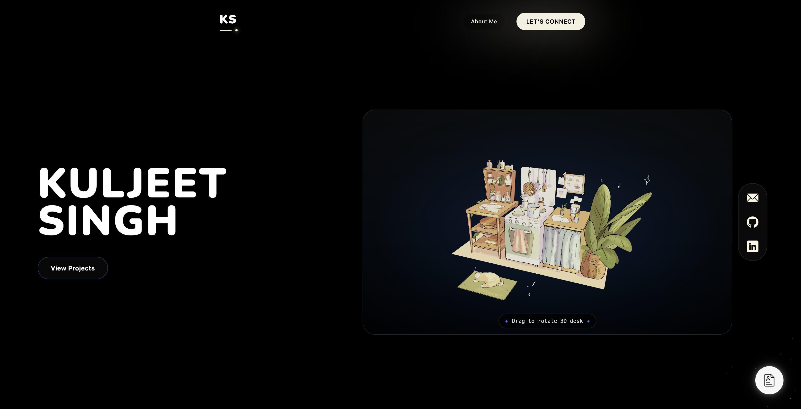
  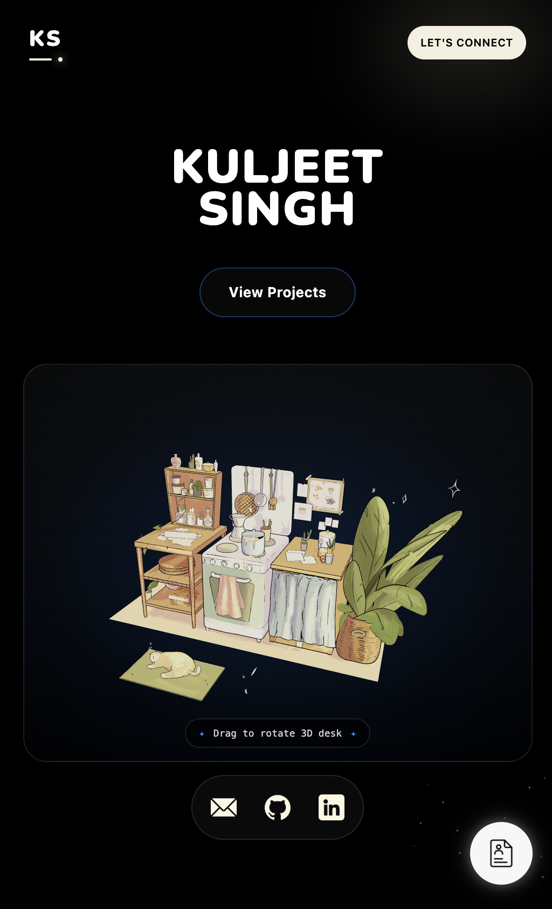
</p>

### macOS-inspired desktop

The About section presents portfolio information inside an iMac-inspired interface with a menu bar, dock, app windows, and Control Center.

<p align="center">
  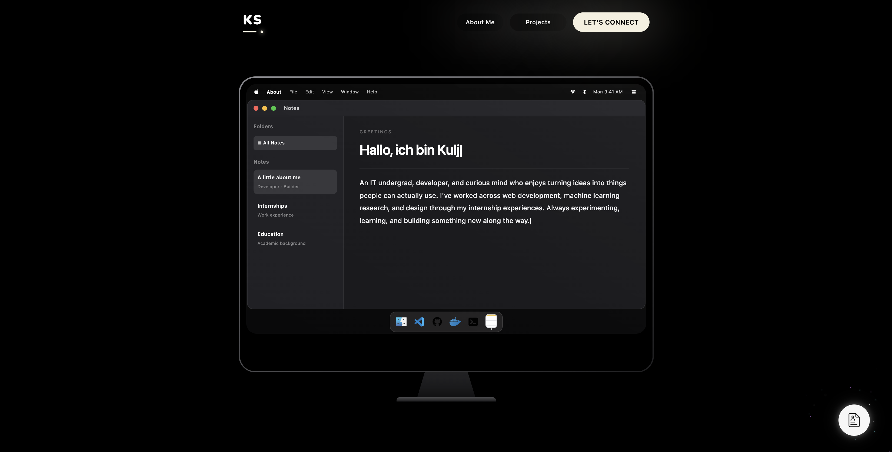
  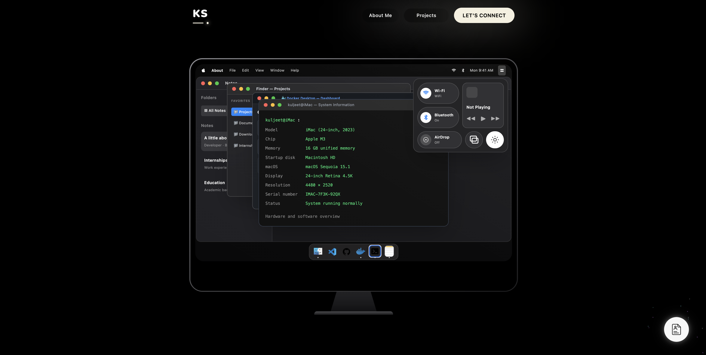
</p>

### Watch layouts

<p align="center">
  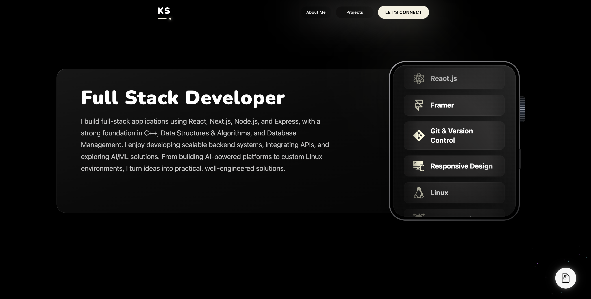
  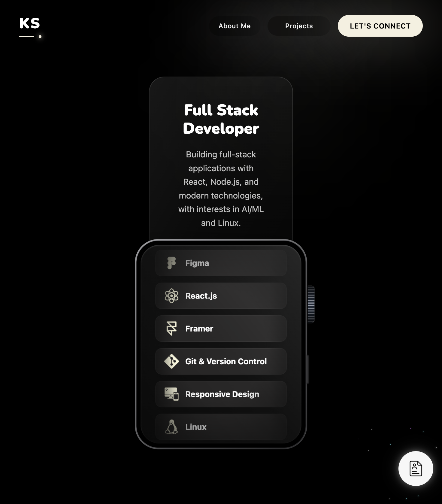
</p>

### Tablet layouts

<p align="center">
  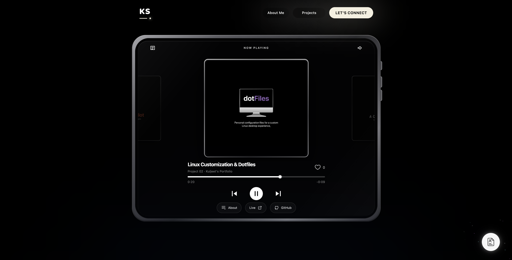
  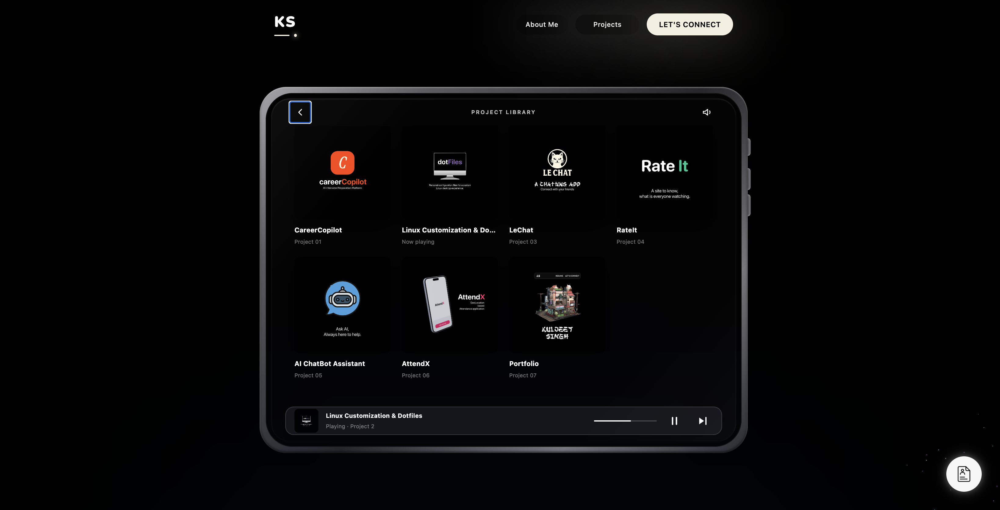
</p>

### Contact interface

<p align="center">
  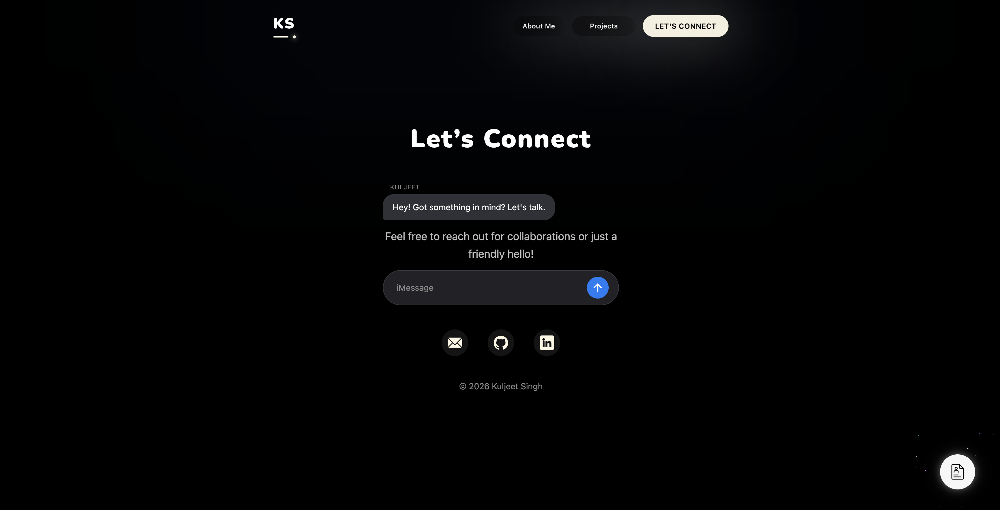
  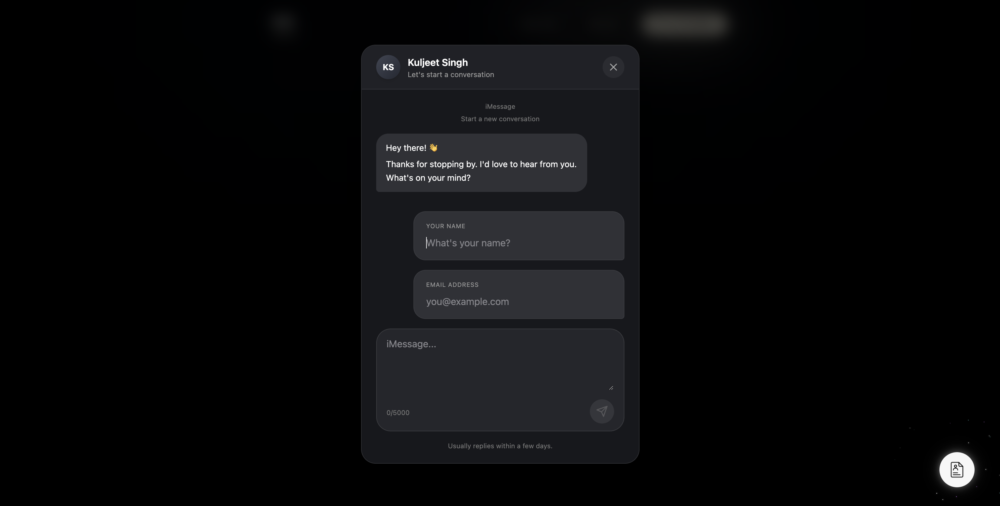
</p>

## Features

### Interactive 3D hero

- Renders [`public/models/desk.glb`](public/models/desk.glb) with Three.js and React Three Fiber.
- Loads the GLB model with `GLTFLoader` and a Draco decoder.
- Supports drag-to-rotate controls, automatic camera fitting, loading progress, and WebGL 2 fallback messaging.

### macOS-inspired About section

- Presents profile, experience, and education content inside an interactive desktop-style frame.
- Includes a menu bar, dock, Control Center, light/dark appearance toggle, and draggable app windows.
- Uses macOS visual patterns as part of the portfolio UI; it does not control the visitor's computer or launch native applications.

### Skills and projects

- Displays the skills list in a watch-inspired panel.
- Showcases projects with descriptions and available live-demo and source-code links.
- Uses responsive layouts and motion across the portfolio sections.

### Dotfiles guide

The `/dotFiles` page documents a Hyprland and Wayland desktop setup. It includes package information, distribution-specific installation commands, configuration snippets, keyboard shortcuts, and copyable setup instructions.

### Resume page

The `/resume` page embeds the PDF at `public/resume.pdf` and provides open, print, and download controls.

### Contact form

The contact panel uses an iMessage-style interface. It submits the visitor's name, email address, and message to the `/api/contact` Vercel Function. The function validates the request, sends the message to the configured inbox through Resend, and attempts to send the visitor a thank-you email from a custom-domain sender.

## Technology

| Area             | Tools                                             |
| ---------------- | ------------------------------------------------- |
| Frontend         | React 19, TypeScript, Vite                        |
| Styling          | Tailwind CSS 4                                    |
| 3D               | Three.js, React Three Fiber, Drei, `three-stdlib` |
| Animation        | Framer Motion, React Spring for Three             |
| Routing          | React Router                                      |
| Contact delivery | Vercel Functions, Resend                          |
| Deployment       | Vercel                                            |

## Routes and architecture

| Route               | Page                                                                 |
| ------------------- | -------------------------------------------------------------------- |
| `/`                 | Portfolio home: hero, About, skills, projects, and contact sections. |
| `/resume`           | Embedded resume viewer and PDF actions.                              |
| `/dotFiles`         | Interactive Linux dotfiles and setup guide.                          |
| `POST /api/contact` | Serverless contact endpoint; accepts JSON form submissions.          |

The frontend is a Vite-powered React single-page application. Route composition is in `src/App.tsx`; the home page is assembled from reusable components in `src/components/`. Static media is served from `public/`. Vercel serves the contact handler from `api/contact.ts` and uses `vercel.json` to route client-side page requests to the application.

The contact request follows this path:

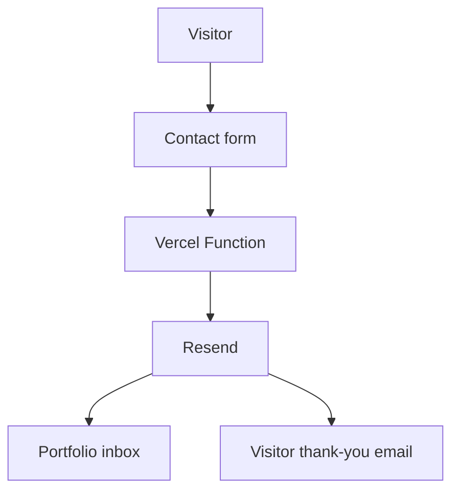

## Getting started

### Prerequisites

- Node.js and npm
- A WebGL 2-capable browser for the 3D scene

### Install and run the frontend

```bash
npm ci
npm run dev
```

Vite prints the local development URL in the terminal. The Vite server serves the frontend only; it does not run the Vercel contact function. To exercise the contact endpoint locally, use the Vercel CLI with `vercel dev` and configure the environment variables below.

### Available scripts

| Command           | Description                                                        |
| ----------------- | ------------------------------------------------------------------ |
| `npm run dev`     | Start the Vite development server.                                 |
| `npm run build`   | Type-check the project and build the production assets in `dist/`. |
| `npm run preview` | Serve the production build locally.                                |
| `npm run lint`    | Run ESLint.                                                        |

## Contact configuration

The contact function reads these server-side environment variables:

| Variable             | Purpose                                            |
| -------------------- | -------------------------------------------------- |
| `RESEND_API_KEY`     | Resend API credential used by the Vercel Function. |
| `CONTACT_TO_EMAIL`   | Destination inbox for portfolio messages.          |
| `CONTACT_FROM_EMAIL` | Sender address on a domain verified with Resend.   |

Add the values to `.env.local` for local Vercel development and to the Vercel project's environment settings for deployment. Use a sender domain verified in Resend. Do not expose these values through client-side variables such as `VITE_*` or commit them to the repository. The repository's `.gitignore` excludes `.env` files.

The contact flow includes input validation and length limits, a honeypot field, a client-side request timeout, and HTML escaping for email content. A visitor confirmation is sent after the owner notification succeeds; if the confirmation email fails, the message itself can still be accepted.

## Deployment

The project is configured for Vercel:

1. Import the repository into a Vercel project.
2. Add `RESEND_API_KEY`, `CONTACT_TO_EMAIL`, and `CONTACT_FROM_EMAIL` to the Vercel environment settings.
3. Verify the sender domain in Resend and use an address from that domain for `CONTACT_FROM_EMAIL`.
4. Deploy the project.

Vercel builds the frontend with `npm run build`, serves the generated `dist/` assets, and deploys `api/contact.ts` as a function. The rewrite in [`vercel.json`](vercel.json) supports the client-side routes.

## Project structure

```text
.
├── api/
│   └── contact.ts            # Vercel contact function and email templates
├── public/
│   ├── icons/                 # UI, skill, project, and social icons
│   ├── models/desk.glb       # 3D desk model used in the hero
│   ├── project-images/       # README screenshots for desktop, devices, and contact
│   └── resume.pdf            # Resume displayed on /resume
├── src/
│   ├── components/            # Portfolio sections and shared UI
│   ├── pages/                 # Dotfiles guide and resume page
│   ├── App.tsx                # Route definitions and home page composition
│   └── App.css                # Global styles and Tailwind import
├── index.html
├── vercel.json
└── package.json
```

## Updating content

- Edit project entries and links in `src/components/Projects.tsx`.
- Edit skills and icons in `src/components/TechStack.tsx`.
- Edit About section content and desktop interactions in `src/components/About.tsx`.
- Replace the 3D asset at `public/models/desk.glb`. If its path changes, update `MODEL_GLB` in `src/components/Hero.tsx`.
- Replace `public/resume.pdf` to publish an updated resume.
- The README screenshots are stored in `public/project-images/` and embedded above.

---

Portfolio by [Kuljeet Singh](https://github.com/kulj33t).
